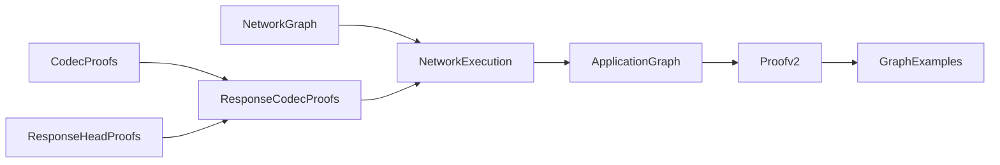

# 证明文件关系

本目录只有一套当前的网络证明，入口是 `Proofv2.lean`。文件名中的 `v2`
沿用此前命名，不表示还保留了另一套旧版证明。早期依赖 `hBackend` 的独立
策略证明以及旧的调用记录图均已删除。

从仓库根目录检查：

```sh
lake -d examples/frontend-backend build Proof.Proofv2 Proof.GraphExamples
```

## 主线

下面箭头表示“被右侧文件直接 import”，只展示主线。



| 文件 | 职责 | 直接依赖的本目录文件 |
| --- | --- | --- |
| [NetworkGraph.lean](NetworkGraph.lean) | 定义调用效果 `AppM`、保存实际 handler 和可达边的图；证明 monad 法则及无环性。 | 无；导入实际 FrontendCore、BackendCore |
| [NetworkExecution.lean](NetworkExecution.lean) | 定义 Socket/Transport 契约；在固定图上执行 handler、编码、传输、解析；定义客户端观察结果、请求要求和预期资源。 | NetworkGraph、ResponseCodecProofs |
| [ApplicationGraph.lean](ApplicationGraph.lean) | 构造指定的 client → frontend → backend 网络，证明节点 handler、地址和可达边符合应用定义。 | NetworkExecution |
| [Proofv2.lean](Proofv2.lean) | 组合 handler、HTTP 和网络证明，得到 `remote_resource_iff_credentials`；同时提供适用于更大图的辅助定理。 | ApplicationGraph |
| [GraphExamples.lean](GraphExamples.lean) | 在 client 加四个服务的图上实例化证明；图允许分支及共享 backend，两个额外 handler 任意。实际 frontend 仍使用直达 backend 的边。 | Proofv2 |

建议先读 NetworkGraph → NetworkExecution → ApplicationGraph → Proofv2。
GraphExamples 展示如何复用；理解主定理不需要先读底层字符串证明。

## HTTP 与服务证明

这里列出全部其余 Lean 文件。依赖列只列本目录中的直接 import，省略 Lean
标准库、HTTP 实现和应用 core；它反映模块依赖，不表示每个定理都使用该模块
中的所有引理。

| 文件 | 证明的内容 | 直接依赖的本目录文件 |
| --- | --- | --- |
| [ServiceProofs.lean](ServiceProofs.lean) | frontend 拒绝时不调用上游、授权时产生预期调用；凭据判定、请求改写、凭据头移除等局部性质。调用记录仅用于这些局部引理，不是网络图。 | 无 |
| [ForwardingProofs.lean](ForwardingProofs.lean) | 定义现有 `ForwardingConstraint`；证明改写后仍满足相关限制、转发头长度低于解析器上限。 | ServiceProofs |
| [CodecProofs.lean](CodecProofs.lean) | 从解析成功推导字段合法性；证明转发请求编码再解析成功，恢复所需 method、target、body 等字段。 | ForwardingProofs、ByteFramingProofs、RequestHeadProofs、HTTPDecimalProofs |
| [ResponseCodecProofs.lean](ResponseCodecProofs.lean) | 定义完整响应解码和状态码/正文观察；证明 JSON、resource、401 响应往返，以及 frontend 再编码保持所需结果。 | ServiceProofs、CodecProofs、ResponseHeadProofs |
| [RequestHeadProofs.lean](RequestHeadProofs.lean) | 请求行和头字段编码后的重新解析；处理头值规范化，恢复 Host、Content-Length 等字段。 | HTTPStringProofs、TrimProofs、ForwardingProofs、DecimalProofs、RequestFramingProofs、ResponseHeadProofs |
| [ResponseHeadProofs.lean](ResponseHeadProofs.lean) | JSON 响应头的拆行、Content-Length 解析和头部结束位置。 | AsciiHTTPProofs、DecimalProofs、TrimProofs、ServiceProofs |
| [RequestFramingProofs.lean](RequestFramingProofs.lean) | 证明请求头的 CRLFCRLF 分隔符恰好出现在预期位置。 | ByteFramingProofs、StringJoinProofs |
| [ByteFramingProofs.lean](ByteFramingProofs.lean) | 字节查找返回首个匹配位置、切片性质，以及追加正文不改变已有分隔符位置。 | 无 |
| [DecimalProofs.lean](DecimalProofs.lean) | 自然数转十进制字符串再用 `toNat?` 解析，恢复原数。 | 无 |
| [HTTPDecimalProofs.lean](HTTPDecimalProofs.lean) | HTTP 解析器自己的十进制解析函数也能恢复编码出的长度。 | DecimalProofs |
| [AsciiHTTPProofs.lean](AsciiHTTPProofs.lean) | ASCII 情况下 HTTP 文本的字节位置、字符串拆分和 CRLF/冒号分隔性质。 | ByteFramingProofs |
| [HTTPStringProofs.lean](HTTPStringProofs.lean) | 支持一般 UTF-8 字符串的拆分、拼接和重组，供请求行和头字段证明使用。 | AsciiHTTPProofs、StringJoinProofs |
| [StringJoinProofs.lean](StringJoinProofs.lean) | 字符串列表 intercalate 拼接的展开规律。 | 无 |
| [TrimProofs.lean](TrimProofs.lean) | trim 不改变无需裁剪的文本，且裁剪后的字符来自原文本。 | 无 |

全部 19 个 Lean 文件都位于 `GraphExamples` 的传递导入依赖中，没有独立的旧版
证明入口。基础引理虽然编写较早，仍由当前证明使用。

## 证明边界

最终定理使用 Socket 和 Transport 两类契约及已有请求要求，没有假设 backend
直接返回资源或编解码成功。后两者由当前证明推导。

这是实际 handler 在图执行模型中的性质；尚未证明真实服务器与 proxy 的 IO
循环和这个解释器完全对应。完整说明见 [上级 README](../README.md#verification-boundary)。
